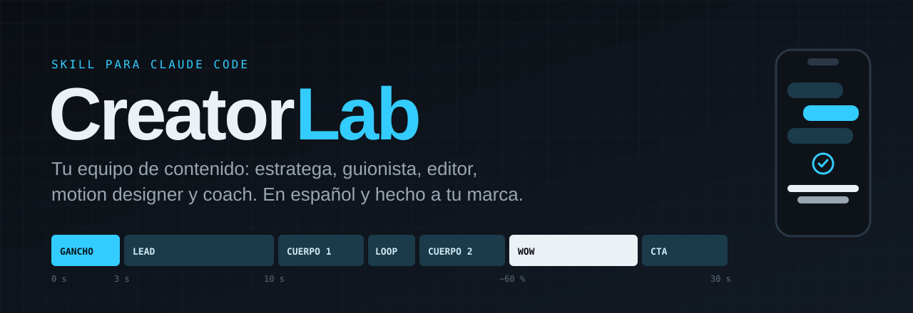
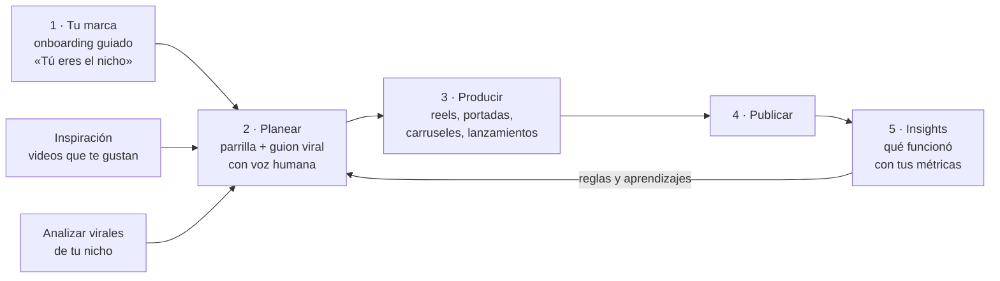

<p align="center">
  
</p>

<p align="center">
  <a href="LICENSE"></a>
  
  
  
</p>

# Creator Lab

Una skill de Claude Code que funciona como tu equipo de contenido. Define tu marca contigo, planea tu parrilla,
escribe guiones con estructura viral que suenan a persona, edita reels con cara y sin cara con motion graphics
(Remotion), hace portadas, carruseles animados y videos de lanzamiento, analiza virales de tu nicho y te dice qué
está funcionando con tus métricas reales.

No solo hace: **explica y enseña**. Cada entrega cierra con por qué se hizo así, un insight para tu marca y qué
métrica revisar. Y aprende: cada corrección tuya se vuelve regla, y cada animación que funciona se guarda en tu
librería para el siguiente reel.

**Para quién:** creadores y founders que quieren contenido con identidad propia, motion graphics y audio limpio sin
abrir un editor de video, y un sistema que aprenda su gusto pieza tras pieza.

**Guía visual con ejemplos:** https://claude.ai/artifact/GGL4hszo5EuhzijouirN7t

## Cómo funciona



| Modo | Lo que hace | El experto que actúa |
|---|---|---|
| `marca` | Onboarding: mensaje, pilares, avatar, historias, voz, marcas, colores y logo desde tu página | Estratega de marca |
| `personalizar` | Cambia lo que quieras hablando normal: colores, marcas, ganchos, reglas, pilares, parrilla | Estratega de marca |
| `planear` | De la fila de tu parrilla a un guion viral listo para grabar, con su carpeta | Guionista y estratega |
| `reel` | Del audio o la toma al video final: corte, voz, música, efectos, motion y subtítulos | Editor, motion designer e ingeniero de audio |
| `portada` | Portadas estilo serie | Director de arte |
| `carrusel` | Láminas animadas 1080×1350 en MP4, PNG y PDF | Diseñador editorial |
| `lanzamiento` | Videos de lanzamiento: el evento y lo que tu producto puede hacer | Director creativo de comerciales |
| `analizar` | Desmenuza virales: gancho, ritmo, cortes, momento wow y cómo replicarlo | Analista de contenido viral |
| `insights` | Qué repetir, qué cambiar y qué mover, con tus números reales | Estratega de datos |
| `ronda` | Opciones de estilo lado a lado y bitácora de ideas | Director de arte |
| `libreria` | Guarda cada animación que funcionó para reusarla | Productor |
| `auditoria` | Revisa piezas terminadas contra tus reglas | Editor en jefe |
| `panel` | Tu página visual para ver y editar todo, separada por marca | Productor |

## Qué necesitas

- **Claude Code** (app de escritorio, CLI o claude.ai/code).
- **Python 3.10+** con las dependencias de `requirements.txt` (`faster-whisper`, `numpy`, `Pillow`, `rembg`, `playwright`).
- **ffmpeg** (y `ffprobe`) en el PATH, para cortar, medir y mezclar audio y video.
- **Node.js 18+** para el kit de Remotion (`kit/`). Chrome es opcional: Remotion baja el suyo.
- **Opcional:** el conector de Google Sheets en Claude, si planeas tu parrilla en una hoja (si no tienes una, el
  onboarding te la arma).

## Instalación

### Opción 1: pídeselo a Claude Code (la más fácil, aunque empieces de cero)

Abre Claude Code y pega esto tal cual:

```
Instala Creator Lab desde cero en esta computadora:
1. Revisa si tengo git, Python 3.10+, ffmpeg y Node.js 18+; instala solo lo que falte (dime antes qué vas a instalar).
2. Clona https://github.com/diegomurilloy/Creator-Lab.git en ~/.claude/skills/creator-lab (si ya existe, haz git pull).
3. Sigue INSTALAR.md de ese repo: dependencias de Python, Chromium de Playwright y npm install del kit.
4. Corre python scripts/verificar_instalacion.py y arregla lo que salga en rojo.
5. Dime cuando esté listo para escribir /creator-lab.
```

Claude revisa tu computadora, instala lo que falte (te pregunta antes), verifica que todo funcione y te avisa.
Abre una sesión nueva y escribe `/creator-lab`. El paso a paso completo está en **[INSTALAR.md](INSTALAR.md)**.

### Opción 2: un comando en tu terminal

Clona el repo directo en tu carpeta de skills de Claude Code:

**macOS / Linux**
```bash
git clone https://github.com/diegomurilloy/Creator-Lab.git ~/.claude/skills/creator-lab
pip install -r ~/.claude/skills/creator-lab/requirements.txt
```

**Windows (PowerShell)**
```powershell
git clone https://github.com/diegomurilloy/Creator-Lab.git "$env:USERPROFILE\.claude\skills\creator-lab"
pip install -r "$env:USERPROFILE\.claude\skills\creator-lab\requirements.txt"
```

Abre una sesión nueva de Claude Code y escribe `/creator-lab`.

> Para portadas y carruseles también corre una vez `python -m playwright install chromium`.

### Opción 3: guardarlo en otra carpeta (OneDrive, Documentos…)

Si prefieres tener tu sistema en otra carpeta, clónalo ahí y enlázalo a tus skills:

```bash
git clone https://github.com/diegomurilloy/Creator-Lab.git creator-lab
```

- **Windows** (CMD, sin permisos de administrador): `mklink /J "%USERPROFILE%\.claude\skills\creator-lab" "<ruta a creator-lab>"`
- **macOS / Linux:** `ln -s "<ruta a creator-lab>" ~/.claude/skills/creator-lab`

### ¿Sin git?

En GitHub, botón verde **Code → Download ZIP**, descomprímelo como `creator-lab` dentro de `~/.claude/skills/`
(en Windows, `%USERPROFILE%\.claude\skills\`). Así funciona igual, pero para actualizar tendrás que volver a
descargarlo; con git es un solo comando.

## Primer uso

Escribe `/creator-lab`. Como todavía no hay nada tuyo, arranca el **onboarding guiado**: Claude te explica qué va a
hacer, te pregunta en bloques cortos (tu mensaje, tus 4 pilares, tu avatar, tus historias, tu voz, tus marcas, tus
rutas y colores), te muestra lo que entendió y guarda solo cuando confirmas. Usa el framework «Tú eres el nicho»
(`referencias/tu-eres-el-nicho.pdf`).

Todo lo tuyo queda en **`personal/`**, que se crea copiando `plantillas/`: tu config (`personal/config.md`), marca,
paletas, parrilla, ganchos, librería, rechazados, aprendizajes, preferencias de guion y reglas propias. Al final te
resume qué quedó configurado y te sugiere la primera pieza.

## Hazlo tuyo

Todo se cambia hablando normal, en cualquier momento (modo `personalizar`). Claude te dice qué archivo toca, te
muestra antes → después y aplica cuando confirmas; si tienes panel, también lo actualiza:

- «cambia mi color de acento a este verde #2E6B4A»
- «agrega mi marca Café La Esquina, su página es …» / «quita la marca vieja»
- «cambia mi tipografía de títulos a Fraunces»
- «agrega este gancho: …» / «borra la regla de los emojis»
- «cambia mis pilares: …» / «agrega la serie Errores que cometí»
- «agrega una columna Plataforma a mi parrilla»
- «sube mi logo» / «no vuelvas a decir "descubre"» / «hazlo más narrativo»

También tienes un **panel** visual (una página en claude.ai) para ver y editar tu marca, ganchos, ideas, librería y
reglas; dile a Claude «sincroniza Creator Lab» para pasar tus cambios a `personal/`.

## Actualizar

Dile a Claude Code «actualiza Creator Lab», o en tu terminal:

```bash
git -C ~/.claude/skills/creator-lab pull                              # macOS / Linux
git -C "$env:USERPROFILE\.claude\skills\creator-lab" pull             # Windows (PowerShell)
```

El motor (modos, referencias, plantillas, scripts y kit) se actualiza; **`personal/` nunca se toca** porque git la
ignora. Si una plantilla nueva trae campos que no tienes, Claude te los ofrece en la siguiente sesión.

## Cómo se usa

```
/creator-lab                  → onboarding la primera vez; después, dile qué quieres hacer
/creator-lab marca            → arma o afina tu perfil con «Tú eres el nicho»
/creator-lab personalizar     → cambia colores, marcas, ganchos, reglas, pilares o parrilla
/creator-lab panel            → tu página editable · «sincroniza Creator Lab»
/creator-lab planear P04      → lee la fila, crea la carpeta, reescribe el guion con estructura viral
/creator-lab reel P04         → del audio o la toma al final vN.mp4 (corte, voz, música, motion, subtítulos)
/creator-lab portada P04      → portada estilo serie
/creator-lab carrusel C05     → láminas 1080×1350 (MP4/PNG + PDF + preview)
/creator-lab ronda            → opciones de estilo en Style Lab + bitácora de ideas
/creator-lab libreria         → guardar un elemento nuevo en la librería
/creator-lab auditoria P01-P07 → revisar piezas terminadas
/creator-lab analizar         → ficha replicable de un video viral (lo bajas tú a personal/virales/)
/creator-lab insights         → qué está funcionando, con tus métricas reales
/creator-lab lanzamiento      → video de lanzamiento de un producto o función
```

También funciona sin comando: «haz el reel de P04, el audio está en Descargas».

## Qué hay aquí

| Carpeta / archivo | Para qué |
|---|---|
| `SKILL.md` | La entrada: dos capas (motor y `personal/`), rutas, onboarding, modos y reglas. |
| `modos/` | Un archivo por modo, cada uno con el rol experto que asume Claude. |
| `referencias/` | Lo genérico: estructura viral, «Tú eres el nicho», voz humana, conexión cultural, estilos con y sin cara, audio, ganchos con crédito, librería del kit y rechazados que aplican a cualquiera. |
| `plantillas/` | Lo que se copia a `personal/` en el onboarding, más `panel.html` y `panel-ejemplo.json` (marca ficticia). |
| `scripts/` | Las herramientas (abajo). Leen `personal/config.md` con `scripts/config.py` o reciben las rutas por argumento. |
| `kit/` | Kit de Remotion plantilla: librería de motion, demos, un reel de ejemplo y 12 efectos de sonido propios. |
| `ejemplos/` | Prompts de motion y edición, utilidades «pro» y una ronda de Style Lab de ejemplo. |
| `personal/` | **Lo tuyo** (ignorado por git). Lo crea el onboarding. |

**Scripts:**
- `transcribir.py`: tiempos por palabra.
- `corte.py`: corte de video en un mp4 continuo.
- `cambiar_palabras.py`: reordenar palabras y quitar silencios a precisión de muestra.
- `rider.py` + `procesar_voz.py`: voz pareja a −14 LUFS.
- `medir_voz.py`: bandas, tramos y ruido.
- `musica.py`: música sintetizada que se corta en los loops.
- `mezcla.py`: mezcla final.
- `hoja_caras.py`, `recorta.py`, `sticker.py`: portadas.
- `hoja_video.py`: auditorías.
- `analizar_video.py`: análisis de videos de referencia (cortes, ritmo, hojas y ficha; rutas relativas).
- `export_carrusel.py`: carruseles (MP4 si la lámina es animada, PNG si no, más PDF y zip).
- `render_ronda.mjs` + `post_ronda.py`: rondas de Style Lab.
- `nueva_pieza.py`: carpetas desde la parrilla.
- `extraer_marca.py`: logo, colores y fuentes desde la página de tu marca.
- `contraste_panel.py`: contraste AA del panel.
- `panel_seed.py`: arma los datos del panel desde `personal/`.
- `exportar_kit.py`: pasa las mejoras de tu kit de trabajo al kit plantilla, sin tu marca.
- `config.py`: lector común de `personal/config.md`.

## El kit de video

`kit/` es un proyecto de Remotion listo para usar (ver `kit/README.md`):


```
cd kit
npm install
npm run studio
```

Trae la librería de motion (`kit/src/libreria/`) con un demo por pieza, un reel de ejemplo sin voz y los efectos de
sonido. Tus colores, fuentes, logo y nombres van en `kit/src/marcas/<id>.ts`; eliges la marca en `kit/src/marca.ts` o
con `REMOTION_MARCA=<id>`. Puedes trabajar ahí o copiarlo a tu carpeta de contenido y poner esa ruta en `kit` de
`personal/config.md`.

## Créditos

- **«Tú eres el nicho»:** el framework es de **Jun Yuh** (@jun_yuh), de su video «You are the niche». Aquí va un
  resumen y una plantilla en español con crédito.
- **Fórmulas de gancho:** `referencias/ganchos.md` cita la cuenta donde se vio cada molde (vía Sandcastles y análisis
  propios); los ejemplos son propios.
- **Style Lab:** el método de revisión por rondas es de Shaan Johari (@viashaan); su plantilla no viene en este repo.
- Hecho por **Diego Murillo** (@diegomurilloy) con Claude Code.

## Licencia

[MIT](LICENSE). Los efectos de sonido de `kit/public/sfx` son propios (sintetizados) y van con la misma licencia.
